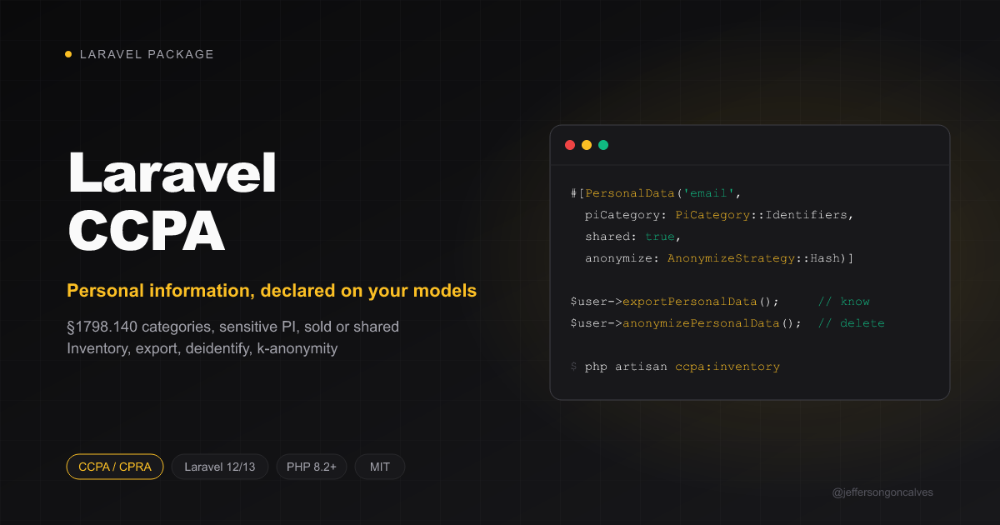

# Laravel CCPA



[](https://packagist.org/packages/jeffersongoncalves/laravel-ccpa)
[](https://github.com/jeffersongoncalves/laravel-ccpa/actions/workflows/tests.yml)
[](https://packagist.org/packages/jeffersongoncalves/laravel-ccpa)

Core of a Laravel toolkit for the California Consumer Privacy Act, as amended by the CPRA (Cal. Civ. Code §1798.100 et seq.). You declare which columns of your Eloquent models hold personal information. With those declarations the package can:

- build the **personal information inventory**: the categories you collect, which ones are sensitive, and which ones you sell or share. That is what your notice at collection and your privacy policy have to disclose (§§1798.100 and 1798.130(a)(5));
- **export** a consumer's personal information (right to know, §1798.110);
- **deidentify** a record, choosing a strategy per column (right to delete, §1798.105).

> This package gives you tooling. It does not make you compliant on its own. You still need legal review for your categories, purposes and retention periods.

## Installation

```bash
composer require jeffersongoncalves/laravel-ccpa
php artisan vendor:publish --tag="ccpa-config"
```

## Declaring personal information

```php
use JeffersonGoncalves\Ccpa\Attributes\PersonalData;
use JeffersonGoncalves\Ccpa\Concerns\InteractsWithPersonalData;
use JeffersonGoncalves\Ccpa\Contracts\HasPersonalData;
use JeffersonGoncalves\Ccpa\Enums\{AnonymizeStrategy, DataCategory, PiCategory};

#[PersonalData('name', purpose: 'Account identification', piCategory: PiCategory::Identifiers, anonymize: AnonymizeStrategy::Mask)]
#[PersonalData('email', piCategory: PiCategory::Identifiers, retention: '5 years', anonymize: AnonymizeStrategy::Hash, shared: true)]
#[PersonalData('ssn', category: DataCategory::Sensitive, piCategory: PiCategory::Identifiers)]
#[PersonalData('purchase_history', piCategory: PiCategory::Commercial, sold: true)]
class User extends Authenticatable implements HasPersonalData
{
    use InteractsWithPersonalData;
}
```

- `piCategory` follows the categories of §1798.140(v)(1): `identifiers`, `customer_records`, `protected_classifications`, `commercial`, `biometric`, `internet_activity`, `geolocation`, `sensory`, `professional`, `education` and `inferences`.
- `category: DataCategory::Sensitive` marks sensitive personal information (§1798.140(ae)): government identifiers, account log-in, precise geolocation, health, biometric data and so on. Consumers can limit its use (§1798.121).
- `sold` and `shared` mark columns you sell, or share for cross-context behavioral advertising (§1798.140(ad) and (ah)). Consumers can opt out of both (§1798.120).

Register the model in `config/ccpa.php`:

```php
'models' => [
    App\Models\User::class,
],
```

### Deidentify strategies

| Strategy | Result |
|---|---|
| `Nullify` (default) | `null` |
| `Hash` | HMAC-SHA256 keyed by `CCPA_HASH_KEY` (falls back to `APP_KEY`). It gives a stable pseudonym, so unique indexes keep working |
| `Mask` | `Mary Smith` → `M*********` |
| `Keep` | untouched, for data you must keep (a §1798.105(d) exception, such as a legal obligation) |

Encrypted casts (`'encrypted'`) work as expected: the value is decrypted, then deidentified, then encrypted again.

## Usage

```php
use JeffersonGoncalves\Ccpa\Facades\Ccpa;

Ccpa::inventory();                 // one row per declared column, with pi_category, sold and shared
$user->exportPersonalData();       // ['name' => ..., 'email' => ..., ...]
$user->anonymizePersonalData();    // applies each strategy and saves
```

`anonymizePersonalData()` fires `JeffersonGoncalves\Ccpa\Events\PersonalDataAnonymized` with the model and the columns it changed. Columns marked `Keep` are not in that list.

```bash
php artisan ccpa:inventory          # table
php artisan ccpa:inventory --json   # machine readable
```

## k-anonymity

Deidentified information must not reasonably be linkable to a consumer (§1798.140(m)). Before you share or publish a dataset as deidentified, check that nobody can be singled out by combining quasi-identifiers such as ZIP code, birth date and gender. A dataset is *k*-anonymous when every combination of those values is shared by at least *k* rows. It is *l*-diverse when each of those groups also holds at least *l* distinct sensitive values.

```php
use JeffersonGoncalves\Ccpa\Facades\Ccpa;
use JeffersonGoncalves\Ccpa\Generalize;

Ccpa::kAnonymity(Patient::class, [
    'zip' => Generalize::prefix(3),         // 94110 → 941
    'birth_date' => Generalize::date('Y'),  // 1990-03-01 → 1990
    'age' => Generalize::range(10),         // 34 → 30-39
    'gender',                               // as stored
], k: 5, sensitive: 'diagnosis');

// ['rows' => 1200, 'groups' => 87, 'k' => 3, 'rows_below_k' => 14, 'l' => 1]
```

```bash
php artisan ccpa:k-anonymity "App\Models\Patient" zip birth_date --k=5 --sensitive=diagnosis
```

The command fails (exit code 1) when the data is below the target *k*, so it can run in CI or before a scheduled export.

## Testing

```bash
composer test
```

## Changelog

See [CHANGELOG](CHANGELOG.md).

## License

The MIT License (MIT). See [License File](LICENSE.md).
